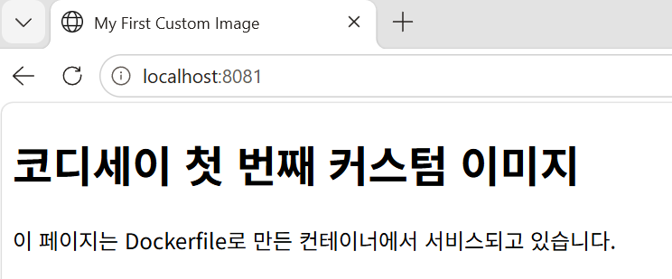
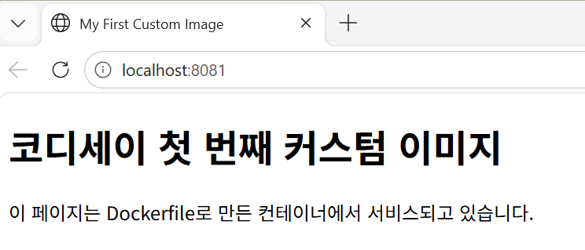
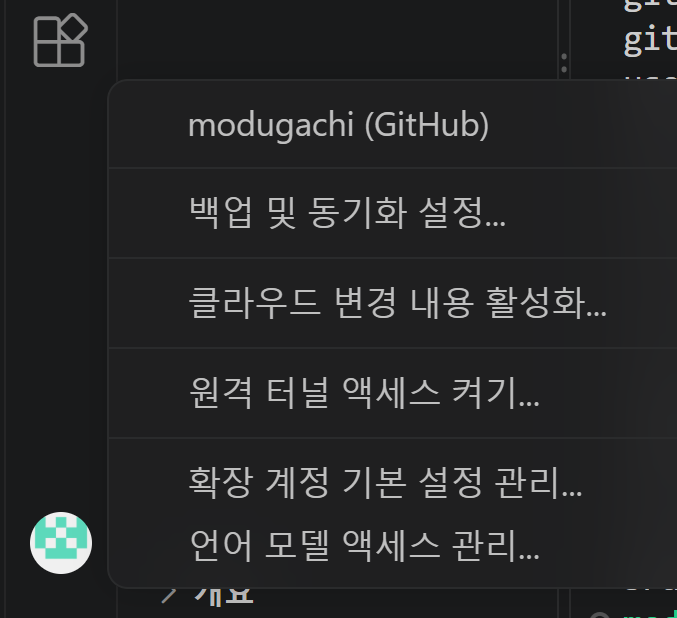
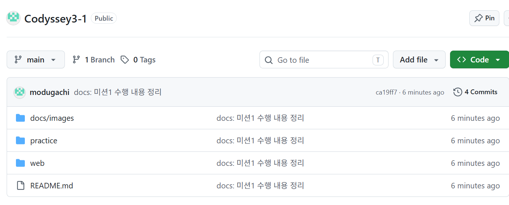

# 개발 워크스테이션 구축 (미션 1)

> 터미널 · Docker · Git/GitHub으로 재현 가능한 개발 환경을 직접 구성하고, 모든 수행 결과를 증거와 함께 기록한 문서입니다.

## 목차

1. [프로젝트 개요](#1-프로젝트-개요)
2. [실행 환경](#2-실행-환경)
3. [수행 항목 체크리스트](#3-수행-항목-체크리스트)
4. [터미널 조작 로그](#4-터미널-조작-로그)
5. [Docker 설치 및 점검](#5-docker-설치-및-점검)
6. [Docker 기본 운영 명령](#6-docker-기본-운영-명령)
7. [컨테이너 실행 실습](#7-컨테이너-실행-실습)
8. [Dockerfile 기반 커스텀 이미지](#8-dockerfile-기반-커스텀-이미지)
9. [포트 매핑 접속 증거](#9-포트-매핑-접속-증거)
10. [바인드 마운트 반영 검증](#10-바인드-마운트-반영-검증)
11. [Docker 볼륨 영속성 검증](#11-docker-볼륨-영속성-검증)
12. [Git 설정 및 GitHub 연동](#12-git-설정-및-github-연동)
13. [검증 방법 요약](#13-검증-방법-요약)
14. [트러블슈팅](#14-트러블슈팅)
15. [학습 내용 정리](#15-학습-내용-정리)
16. [보너스 과제](#16-보너스-과제)
17. [보안 및 개인정보 점검](#17-보안-및-개인정보-점검)
18. [재현 방법](#18-재현-방법)

---

## 1. 프로젝트 개요

개발은 코드를 쓰기 전에 **작업 환경을 직접 세팅하는 것**에서 시작된다. 이 프로젝트는 터미널(리눅스 CLI), Docker, Git/GitHub 세 가지 도구를 직접 다루면서, 같은 환경을 **어느 PC에서나 반복해서 재현**할 수 있는 개발 작업실을 만드는 것이 목표이다. 명령어를 따라 치는 데서 끝나지 않고, 실행 결과(출력, 접속 화면, 데이터 유지 여부)로 동작을 확인하고 **왜 그렇게 동작하는지**를 정리했다.

### 수행 범위

| 영역 | 수행 내용 | 위치 |
| --- | --- | --- |
| 터미널 | 위치·목록 확인, 이동, 생성, 복사, 이동/이름 변경, 삭제, 파일 내용 확인 | [4.1](#41-기본-조작) |
| 권한 | 파일·디렉토리의 권한 변경 전/후 비교, 실제 접근 차단 관찰 | [4.2](#42-권한-실습) |
| Docker 기본 | 설치·데몬 점검, 이미지·컨테이너 관리, 로그·리소스 확인 | [5장](#5-docker-설치-및-점검), [6장](#6-docker-기본-운영-명령) |
| 컨테이너 실습 | hello-world, ubuntu 진입, `exec`와 `attach`의 차이 관찰 | [7장](#7-컨테이너-실행-실습) |
| Dockerfile | NGINX 베이스로 웹페이지를 교체한 커스텀 이미지 제작 | [8장](#8-dockerfile-기반-커스텀-이미지) |
| 포트 매핑 | 같은 이미지를 두 포트로 실행하고 접속 확인 | [9장](#9-포트-매핑-접속-증거) |
| 데이터 연결 | 바인드 마운트(즉시 반영)와 볼륨(영속성) 검증 | [10장](#10-바인드-마운트-반영-검증), [11장](#11-docker-볼륨-영속성-검증) |
| Git/GitHub | 사용자 설정, VS Code 로그인·연동, 저장소 push | [12장](#12-git-설정-및-github-연동) |
| 정리 | 검증 요약, 트러블슈팅, 학습 내용, 보안 점검, 재현 방법 | [13장](#13-검증-방법-요약) ~ [18장](#18-재현-방법) |

### 사용 도구

| 도구 | 용도 |
| --- | --- |
| Ubuntu (WSL2) | 리눅스 명령(CLI) 실습 환경 |
| Docker | 이미지 빌드와 컨테이너 실행 |
| Git / GitHub | 변경 이력 관리와 PC 간 작업 동기화, 결과물 제출 |
| VS Code (WSL 확장) | 파일 작성과 WSL 터미널 사용 |

작업 도중 PC를 바꾸었다. 그래서 **GitHub 저장소를 원본**으로 두고 PC마다 환경(WSL, Docker)을 다시 구성했으며, 이 문서의 모든 출력은 현재 PC(`GNIA-C402-E03`)에서 다시 실행해 얻은 값이다.

### 저장소 구조

```
.
├── README.md        # 이 문서 (수행 로그와 증거)
├── practice/        # 터미널·권한 실습 파일
├── web/             # Dockerfile 기반 웹 서버
│   ├── Dockerfile
│   └── site/
│       └── index.html
└── docs/
    └── images/      # 접속 화면 등 스크린샷 증거
```

## 2. 실행 환경

| 항목 | 내용 |
| --- | --- |
| OS | Windows + WSL2 |
| Linux | Ubuntu 26.04.1 LTS |
| Shell / Terminal | bash / VS Code 통합 터미널 |
| Docker | 29.1.3 (apt `docker.io`로 설치) |
| Git | 2.53.0 |
| 에디터 | VS Code + WSL 확장 |

- 작업 PC 이름은 `GNIA-C402-E03`이고, 프로젝트는 리눅스 홈(`~/Codyssey3-1`) 안에 두었다. (`/mnt/c` 경로에서는 `chmod` 권한이 제대로 동작하지 않기 때문)
- 아래 값은 명령 출력으로 확인했다. (`lsb_release -a`, `echo $SHELL`, `git --version`, `docker --version`)

```bash
$ lsb_release -a
No LSB modules are available.
Distributor ID: Ubuntu
Description:    Ubuntu 26.04.1 LTS
Release:        26.04
Codename:       resolute
$ echo $SHELL
/bin/bash
$ git --version
git version 2.53.0
$ docker --version
Docker version 29.1.3, build 29.1.3-0ubuntu4.1
```

## 3. 수행 항목 체크리스트

<!-- 체크 기준: 실습을 했고, 그 증거(명령 + 출력)가 이 문서 본문에 들어 있을 때만 [x] -->

- [x] 터미널 기본 조작 및 폴더 구성 → [4.1](#41-기본-조작)
- [x] 권한 변경 실습 (파일 1개, 디렉토리 1개) → [4.2](#42-권한-실습)
- [x] Docker 설치/점검 → [5장](#5-docker-설치-및-점검)
- [x] Docker 기본 운영 명령 → [6장](#6-docker-기본-운영-명령)
    - [x] 이미지 목록 (`docker images`)
    - [x] 이미지 다운로드 (`docker pull`)
    - [x] 컨테이너 목록 (`docker ps`, `docker ps -a`)
    - [x] 로그 확인 (`docker logs`)
    - [x] 리소스 확인 (`docker stats`)
    - [x] 컨테이너 중지/삭제 (`docker stop`, `docker rm`)
- [x] hello-world 실행 → [7.1](#71-hello-world)
- [x] ubuntu 컨테이너 진입 (`ls`, `echo`) → [7.2](#72-ubuntu-컨테이너-진입)
- [x] attach/exec 종료·유지 차이 관찰 → [7.3](#73-attach와-exec의-차이)
- [x] Dockerfile 직접 작성, 빌드/실행 → [8장](#8-dockerfile-기반-커스텀-이미지)
- [x] 포트 매핑 접속 (8080, 8081 주소창 포함 캡처) → [9장](#9-포트-매핑-접속-증거)
- [x] 바인드 마운트 반영 (호스트 변경 전/후) → [10장](#10-바인드-마운트-반영-검증)
- [x] 볼륨 영속성 (컨테이너 삭제 전/후) → [11장](#11-docker-볼륨-영속성-검증)
- [x] Git 설정 (`git config --list`) → [12.1](#121-git-설정)
- [x] VS Code GitHub 로그인·저장소 연동 증거 → [12.3](#123-연동-증거)
- [x] 트러블슈팅 2건 이상 정리 → [14장](#14-트러블슈팅)
- [ ] 학습 내용 정리 (본인 말로 완성) → [15장](#15-학습-내용-정리)
- [ ] 보안·개인정보 점검 → [17장](#17-보안-및-개인정보-점검)

## 4. 터미널 조작 로그

### 4.1 기본 조작

#### 4.1.1 현재 위치 확인 (pwd)

- 목적: 현재 작업 중인 디렉토리의 절대 경로 확인

```bash
modugachi@GNIA-C402-E03:~/Codyssey3-1$ pwd
/home/modugachi/Codyssey3-1
```

- 확인한 점: 경로가 `/home/...`으로 시작하므로 리눅스(Ubuntu, WSL) 환경 안에서 작업 중임을 확인했다.

#### 4.1.2 목록 확인, 숨김 파일 포함 (ls, ls -al)

- 목적: 숨김 파일을 포함한 현재 폴더의 전체 목록 확인

```bash
modugachi@GNIA-C402-E03:~/Codyssey3-1$ ls
README.md  docs  practice  web
modugachi@GNIA-C402-E03:~/Codyssey3-1$ ls -al
total 28
drwxr-xr-x  6 modugachi modugachi 4096 Nov  8 18:06 .
drwxr-x--- 13 modugachi modugachi 4096 Nov  8 18:04 ..
drwxr-xr-x  7 modugachi modugachi 4096 Nov  8 18:04 .git
-rw-r--r--  1 modugachi modugachi   38 Nov  8 18:04 README.md
drwxr-xr-x  3 modugachi modugachi 4096 Nov  8 18:06 docs
drwxr-xr-x  2 modugachi modugachi 4096 Nov  8 18:06 practice
drwxr-xr-x  3 modugachi modugachi 4096 Nov  8 18:06 web
```

- 확인한 점: `ls`에는 `.git`이 보이지 않고 `ls -al`에서만 보였다. 이름이 `.`으로 시작하는 항목은 숨김이다. `.`은 현재 폴더, `..`은 상위 폴더이고, 맨 앞 글자 `d`는 폴더, `-`는 파일이다.

#### 4.1.3 폴더 생성과 이동 (mkdir, cd)

- 목적: 연습용 폴더 `practice`를 만들고 그 안으로 이동해 위치 확인

```bash
modugachi@GNIA-C402-E03:~/Codyssey3-1$ mkdir -p practice
modugachi@GNIA-C402-E03:~/Codyssey3-1$ ls -l
total 16
-rw-r--r-- 1 modugachi modugachi   38 Nov  8 18:04 README.md
drwxr-xr-x 3 modugachi modugachi 4096 Nov  8 18:06 docs
drwxr-xr-x 2 modugachi modugachi 4096 Nov  8 18:06 practice
drwxr-xr-x 3 modugachi modugachi 4096 Nov  8 18:06 web
modugachi@GNIA-C402-E03:~/Codyssey3-1$ cd practice
modugachi@GNIA-C402-E03:~/Codyssey3-1/practice$ pwd
/home/modugachi/Codyssey3-1/practice
```

- 확인한 점: `mkdir -p`는 폴더가 이미 있어서 출력이 없었고, `ls -l`에서 `practice` 앞에 `d`가 붙어 폴더임을 확인했다. `cd` 후 프롬프트가 `~/Codyssey3-1/practice`로 바뀌었다.

#### 4.1.4 빈 파일 생성 (touch)와 숨김 파일 비교

- 목적: 빈 파일과 숨김 파일을 만들고 `ls`와 `ls -al`의 차이 비교

```bash
modugachi@GNIA-C402-E03:~/Codyssey3-1/practice$ touch empty.txt
modugachi@GNIA-C402-E03:~/Codyssey3-1/practice$ touch .hidden.txt
modugachi@GNIA-C402-E03:~/Codyssey3-1/practice$ ls
empty.txt
modugachi@GNIA-C402-E03:~/Codyssey3-1/practice$ ls -al
total 8
drwxr-xr-x 2 modugachi modugachi 4096 Nov  8 18:14 .
drwxr-xr-x 6 modugachi modugachi 4096 Nov  8 18:06 ..
-rw-r--r-- 1 modugachi modugachi    0 Nov  8 18:14 .hidden.txt
-rw-r--r-- 1 modugachi modugachi    0 Nov  8 18:14 empty.txt
```

- 확인한 점: `ls`에는 `empty.txt`만 보이고 `.hidden.txt`는 `ls -al`에서만 보였다. 두 파일 크기는 0바이트(빈 파일)이다.

#### 4.1.5 파일 내용 쓰기와 확인 (echo, cat)

- 목적: `>`(덮어쓰기)와 `>>`(추가)의 차이 관찰

```bash
modugachi@GNIA-C402-E03:~/Codyssey3-1/practice$ echo "hello codyssey" > hello.txt
modugachi@GNIA-C402-E03:~/Codyssey3-1/practice$ cat hello.txt
hello codyssey
modugachi@GNIA-C402-E03:~/Codyssey3-1/practice$ echo "second line" >> hello.txt
modugachi@GNIA-C402-E03:~/Codyssey3-1/practice$ cat hello.txt
hello codyssey
second line
```

- 확인한 점: `>`로 쓴 뒤에는 한 줄이었고, `>>`를 쓰자 기존 내용 뒤에 한 줄이 추가되어 두 줄이 되었다.

#### 4.1.6 복사 (cp)

- 목적: 파일을 복사하고 원본이 유지되는지 확인

```bash
modugachi@GNIA-C402-E03:~/Codyssey3-1/practice$ cp hello.txt copy.txt
modugachi@GNIA-C402-E03:~/Codyssey3-1/practice$ ls -l
total 8
-rw-r--r-- 1 modugachi modugachi 27 Nov  8 18:17 copy.txt
-rw-r--r-- 1 modugachi modugachi  0 Nov  8 18:14 empty.txt
-rw-r--r-- 1 modugachi modugachi 27 Nov  8 18:16 hello.txt
```

- 확인한 점: `hello.txt`가 그대로 남아 있고 `copy.txt`가 새로 생겼으며, 두 파일 크기가 27바이트로 같다.

#### 4.1.7 이동과 이름 변경 (mv)

- 목적: `mv`로 이름을 바꾸고 다른 폴더로 이동

```bash
modugachi@GNIA-C402-E03:~/Codyssey3-1/practice$ mv copy.txt renamed.txt
modugachi@GNIA-C402-E03:~/Codyssey3-1/practice$ mkdir backup
modugachi@GNIA-C402-E03:~/Codyssey3-1/practice$ mv renamed.txt backup/
modugachi@GNIA-C402-E03:~/Codyssey3-1/practice$ ls -r
hello.txt  empty.txt  backup
modugachi@GNIA-C402-E03:~/Codyssey3-1/practice$ ls -R
.:
backup  empty.txt  hello.txt

./backup:
renamed.txt
```

- 확인한 점: 같은 폴더에서 `mv`를 쓰면 이름이 바뀌고(`copy.txt` → `renamed.txt`), 폴더를 지정하면 이동한다. `ls -r`(소문자)은 이름 역순 정렬일 뿐 하위 폴더 안을 보여주지 않았고, `ls -R`(대문자)에서 `./backup:` 아래의 `renamed.txt`가 보였다. 원본 `copy.txt`는 사라졌다. (옵션 대소문자 혼동은 [14.3](#143-ls-옵션-대소문자-혼동--r---r))

#### 4.1.8 삭제 (rm)

- 목적: 연습용 파일과 폴더를 삭제하고 사라진 것을 확인

```bash
modugachi@GNIA-C402-E03:~/Codyssey3-1/practice$ ls
backup  delete_me.txt  empty.txt  hello.txt
modugachi@GNIA-C402-E03:~/Codyssey3-1/practice$ rm delete_me.txt
modugachi@GNIA-C402-E03:~/Codyssey3-1/practice$ ls
backup  empty.txt  hello.txt
modugachi@GNIA-C402-E03:~/Codyssey3-1/practice$ rm backup
rm: cannot remove 'backup': Is a directory
modugachi@GNIA-C402-E03:~/Codyssey3-1/practice$ rm -r backup
modugachi@GNIA-C402-E03:~/Codyssey3-1/practice$ ls
empty.txt  hello.txt
```

- 확인한 점: 파일은 `rm`만으로 지워졌고, 폴더는 `rm backup`이 `Is a directory`로 거부되어 `-r` 옵션을 붙여야 지워졌다. `rm`은 휴지통이 없어 되돌릴 수 없으므로 연습용 파일만 지웠다.

#### 4.1.9 절대 경로와 상대 경로 이동 비교

- 목적: 상대 경로(`cd ..`)와 절대 경로(`cd ~/Codyssey3-1/practice`)의 동작 비교

```bash
modugachi@GNIA-C402-E03:~/Codyssey3-1$ pwd
/home/modugachi/Codyssey3-1
modugachi@GNIA-C402-E03:~/Codyssey3-1$ cd ..
modugachi@GNIA-C402-E03:~$ pwd
/home/modugachi
modugachi@GNIA-C402-E03:~$ cd ~/Codyssey3-1/practice
modugachi@GNIA-C402-E03:~/Codyssey3-1/practice$ pwd
/home/modugachi/Codyssey3-1/practice
```

- 확인한 점: `cd ..`은 현재 위치(`~/Codyssey3-1`) 기준으로 한 단계 위인 `/home/modugachi`로 이동했다(**상대 경로**). `cd ~/Codyssey3-1/practice`는 홈에서 출발했는데도 `practice`에 도착했다(**절대 경로**). 상대 경로는 실행 위치에 따라 도착지가 달라지고, 절대 경로는 어디서 실행해도 같은 곳에 도착한다. (공백 누락 오류는 [14.4](#144-cd-공백-누락))

### 4.2 권한 실습

#### 4.2.1 파일 권한 변경

- 목적: 파일 1개의 권한을 변경하고 변경 전/후를 비교

```bash
modugachi@GNIA-C402-E03:~/Codyssey3-1/practice$ touch perm_test.txt
modugachi@GNIA-C402-E03:~/Codyssey3-1/practice$ ls -l perm_test.txt
-rw-r--r-- 1 modugachi modugachi 0 Nov  8 18:28 perm_test.txt
modugachi@GNIA-C402-E03:~/Codyssey3-1/practice$ chmod 600 perm_test.txt
modugachi@GNIA-C402-E03:~/Codyssey3-1/practice$ ls -l perm_test.txt
-rw------- 1 modugachi modugachi 0 Nov  8 18:28 perm_test.txt
modugachi@GNIA-C402-E03:~/Codyssey3-1/practice$ chmod 755 perm_test.txt
modugachi@GNIA-C402-E03:~/Codyssey3-1/practice$ ls -l perm_test.txt
-rwxr-xr-x 1 modugachi modugachi 0 Nov  8 18:28 perm_test.txt
```

- 확인한 점: 권한이 `-rw-r--r--`(644) → `-rw-------`(600) → `-rwxr-xr-x`(755)로 바뀌었다. 600은 소유자만 읽기·쓰기, 755는 소유자 전체 권한에 그룹·기타는 읽기·실행이다. 755가 되자 터미널에서 파일 이름이 초록색(실행 가능 표시)으로 바뀌었다.

#### 4.2.2 디렉토리 권한 변경 (ls -ld)

- 목적: 디렉토리 1개의 권한을 변경하고 변경 전/후를 비교 (`-d`는 폴더 안이 아니라 폴더 자신의 정보를 보는 옵션)

```bash
modugachi@GNIA-C402-E03:~/Codyssey3-1/practice$ mkdir perm_dir
modugachi@GNIA-C402-E03:~/Codyssey3-1/practice$ ls -ld perm_dir
drwxr-xr-x 2 modugachi modugachi 4096 Nov  8 18:29 perm_dir
modugachi@GNIA-C402-E03:~/Codyssey3-1/practice$ chmod 700 perm_dir
modugachi@GNIA-C402-E03:~/Codyssey3-1/practice$ ls -ld perm_dir
drwx------ 2 modugachi modugachi 4096 Nov  8 18:29 perm_dir
```

- 확인한 점: `drwxr-xr-x`(755)가 `drwx------`(700)로 바뀌어 소유자 외에는 접근 권한이 없어졌다.

#### 4.2.3 권한이 실제로 막는 모습 (Permission denied)

- 목적: 숫자 표기에 그치지 않고 실제 동작이 막히는지 관찰

```bash
modugachi@GNIA-C402-E03:~/Codyssey3-1/practice$ chmod 000 perm_dir
modugachi@GNIA-C402-E03:~/Codyssey3-1/practice$ cd perm_dir
bash: cd: perm_dir: Permission denied
modugachi@GNIA-C402-E03:~/Codyssey3-1/practice$ chmod 755 perm_dir
modugachi@GNIA-C402-E03:~/Codyssey3-1/practice$ cd perm_dir
modugachi@GNIA-C402-E03:~/Codyssey3-1/practice/perm_dir$ cd ..
```

- 확인한 점: 권한이 `000`일 때 `cd`가 `Permission denied`로 막혔고, `755`로 되돌린 뒤에는 폴더 안으로 들어갈 수 있었다(성공한 `cd`는 출력이 없다). 폴더에서 `x` 권한은 "그 안으로 들어갈 수 있는 권한"이다.

#### 권한 해석 정리

| 숫자 | 해석 | 의미 |
| --- | --- | --- |
| 7 | rwx (4+2+1) | 읽기, 쓰기, 실행 |
| 6 | rw- (4+2) | 읽기, 쓰기 |
| 5 | r-x (4+1) | 읽기, 실행 |
| 0 | --- | 권한 없음 |

- `755` = `rwxr-xr-x` (소유자 rwx, 그룹 r-x, 기타 r-x)
- `644` = `rw-r--r--` (소유자 rw-, 그룹 r--, 기타 r--)

## 5. Docker 설치 및 점검

- 설치 방식: Ubuntu(WSL)에 `sudo apt install -y docker.io`로 설치했다.

```bash
modugachi@GNIA-C402-E03:~/codyssey-repo$ docker --version
Docker version 29.1.3, build 29.1.3-0ubuntu4.1
$ docker info | grep -E "Server Version|Operating System|OSType|Architecture"
 Server Version: 29.1.3
 Operating System: Ubuntu 26.04.1 LTS
 OSType: linux
 Architecture: x86_64
```

- 확인한 점: `docker --version`으로 Docker 29.1.3 설치를, `docker info`의 `Server Version`과 `OSType: linux`로 데몬(엔진)이 정상 응답함을 확인했다. 설치 직후에는 `permission denied`가 났으나 `docker` 그룹에 추가해 해결했다([14.6](#146-docker-명령-실행-시-permission-denied-dockersock)).

## 6. Docker 기본 운영 명령

### 6.1 이미지 목록 (docker images)

- 목적: 내 PC에 내려받은 이미지 확인

```bash
modugachi@GNIA-C402-E03:~/Codyssey3-1/practice$ docker images
IMAGE           ID             DISK USAGE   CONTENT SIZE   EXTRA
alpine:latest   3f4d6b32e267         13MB         3.94MB
nginx:alpine    713fc2ebfd92       94.5MB         27.3MB    U
```

- 확인한 점: `alpine:latest`, `nginx:alpine` 이미지가 있다. `U`(In Use)는 그 이미지로 만든 컨테이너가 있다는 표시이다(이 시점에는 `nginx:alpine`으로 만든 `log-test`가 실행 중이었다).

### 6.2 컨테이너 목록 (docker ps, docker ps -a)

- 목적: 실행 중인 컨테이너(`ps`)와 종료된 것까지 포함한 전체(`ps -a`) 확인

```bash
$ docker ps
CONTAINER ID   IMAGE          COMMAND                  CREATED          STATUS          PORTS                                         NAMES
d140be43ee55   nginx:alpine   "/docker-entrypoint.…"   42 minutes ago   Up 42 minutes   0.0.0.0:8090->80/tcp, [::]:8090->80/tcp       log-test
$ docker run alpine echo "첫 번째"
첫 번째
$ docker run alpine echo "두 번째"
두 번째
$ docker ps -a
CONTAINER ID   IMAGE          COMMAND                  CREATED          STATUS                     PORTS                                     NAMES
9ab8908ad5f4   alpine         "echo '두 번째'"         5 seconds ago    Exited (0) 4 seconds ago                                             hopeful_ramanujan
ba1c20500e27   alpine         "echo '첫 번째'"         18 seconds ago   Exited (0) 17 seconds ago                                            modest_gould
d140be43ee55   nginx:alpine   "/docker-entrypoint.…"   33 minutes ago   Up 33 minutes              0.0.0.0:8090->80/tcp, [::]:8090->80/tcp   log-test
```

- 확인한 점: `alpine` 이미지는 1개인데 `docker run`을 두 번 하자 컨테이너가 2개 생겼다(같은 이미지로 컨테이너 여러 개). `echo` 컨테이너는 글자를 출력하고 끝나 `Exited (0)`(정상 종료)이고, `log-test`는 `Up`이다. `docker ps`에는 실행 중인 것만, `-a`를 붙이면 종료된 것까지 나온다. 이름은 `--name`을 주지 않아 Docker가 자동으로 붙였다.

### 6.3 출력 열 지정 (--format)

- 목적: 필요한 열만 골라 표로 출력

```bash
$ docker ps -a --format "table {{.ID}}\t{{.Image}}\t{{.Status}}\t{{.Names}}"
CONTAINER ID   IMAGE          STATUS                   NAMES
9ab8908ad5f4   alpine         Exited (0) 8 minutes ago hopeful_ramanujan
ba1c20500e27   alpine         Exited (0) 8 minutes ago modest_gould
d140be43ee55   nginx:alpine   Up 42 minutes            log-test
```

- 확인한 점: `--format`으로 ID, 이미지, 상태, 이름 네 열만 나와 줄바꿈 없이 한눈에 비교할 수 있었다. `--format`은 `docker` 바로 뒤가 아니라 `ps` 같은 하위 명령 뒤에 붙인다.

### 6.4 이미지 다운로드 (docker pull)

- 목적: Docker Hub에서 이미지를 내려받기. `pull`은 실행 없이 이미지만 받는다.

```bash
modugachi@GNIA-C402-E03:~/codyssey-repo$ docker pull alpine:latest
latest: Pulling from library/alpine
881fc932939e: Pull complete
86ff264fe568: Download complete
c35a7d82b8fa: Download complete
Digest: sha256:3f4d6b32e26703c6082839234f43769d5046b3ac7c910033911d1e71d8cd630a
Status: Downloaded newer image for alpine:latest
docker.io/library/alpine:latest
$ docker images
IMAGE           ID             DISK USAGE   CONTENT SIZE   EXTRA
alpine:latest   3f4d6b32e267   13MB         3.94MB
```

- 확인한 점: `Status: Downloaded newer image for alpine:latest`로 새로 내려받았고, `docker images`에 `alpine:latest`(13MB)가 추가되었다. 이미지는 여러 조각(레이어)으로 받으며, `pull`만으로는 컨테이너가 만들어지지 않는다.

### 6.5 로그 확인 (docker logs)

- 목적: 컨테이너가 남긴 로그를 컨테이너 안에 들어가지 않고 호스트에서 확인
- 준비: NGINX 컨테이너 `log-test`를 8090 포트로 실행(`docker run -d --name log-test -p 8090:80 nginx:alpine`)하고 `curl`로 요청 2번을 보냈다.

```bash
$ curl http://localhost:8090
<!DOCTYPE html>
<html>
<head>
<title>Welcome to nginx!</title>
...(중간 생략)
<p><em>Thank you for using nginx.</em></p>
</body>
</html>
$ curl http://localhost:8090/nopage
<html>
<head><title>404 Not Found</title></head>
<body>
<center><h1>404 Not Found</h1></center>
<hr><center>nginx/1.31.8</center>
</body>
</html>
$ docker logs log-test
/docker-entrypoint.sh: Configuration complete; ready for start up
2026/11/08 08:58:31 [notice] 1#1: nginx/1.31.8
...(NGINX 시작 기록 중간 생략)
172.17.0.1 - - [08/Nov/2026:09:41:21 +0000] "GET / HTTP/1.1" 200 896 "-" "curl/8.18.0" "-"
172.17.0.1 - - [08/Nov/2026:09:41:30 +0000] "GET /nopage HTTP/1.1" 404 153 "-" "curl/8.18.0" "-"
2026/11/08 09:41:30 [error] 33#33: *2 open() "/usr/share/nginx/html/nopage" failed (2: No such file or directory), client: 172.17.0.1, server: localhost, request: "GET /nopage HTTP/1.1", host: "localhost:8090"
$ docker logs --tail 3 log-test
172.17.0.1 - - [08/Nov/2026:09:41:21 +0000] "GET / HTTP/1.1" 200 896 "-" "curl/8.18.0" "-"
172.17.0.1 - - [08/Nov/2026:09:41:30 +0000] "GET /nopage HTTP/1.1" 404 153 "-" "curl/8.18.0" "-"
2026/11/08 09:41:30 [error] 33#33: *2 open() "/usr/share/nginx/html/nopage" failed (2: No such file or directory), client: 172.17.0.1, server: localhost, request: "GET /nopage HTTP/1.1" "host: "localhost:8090"
```

- 확인한 점: 정상 요청은 `200`, 없는 주소 요청은 `404`로 기록되었고, 404는 "파일을 찾지 못했다"는 에러 로그도 한 줄 더 남겼다. 로그 앞부분은 NGINX 시작 기록이라 길어서, 마지막 3줄만 보는 `--tail 3`이 유용했다. `curl http://localhost:8090`은 내가 만든 페이지가 아니라 NGINX 기본 페이지다.

### 6.6 리소스 확인 (docker stats)

- 목적: 실행 중인 컨테이너의 CPU, 메모리 사용량 확인

```bash
modugachi@GNIA-C402-E03:~/Codyssey3-1/practice$ docker stats --no-stream
CONTAINER ID   NAME       CPU %     MEM USAGE / LIMIT     MEM %     NET I/O          BLOCK I/O     PIDS
d140be43ee55   log-test   0.00%     18.99MiB / 15.25GiB   0.12%     2.88kB / 2.26kB  0B / 12.3kB   25
```

- 확인한 점: 실행 중인 `log-test`만 표에 나왔고 종료된(`Exited`) 컨테이너 2개는 나오지 않았다. 요청이 없는 웹 서버라 CPU는 0.00%, 메모리는 약 19MiB만 사용했고, `NET I/O`에 `curl` 요청의 흔적이 남았다. `--no-stream`은 한 번만 출력하는 옵션이다.

### 6.7 중지와 삭제 (docker stop, docker rm)

- 목적: 컨테이너 수명 주기(실행 → 중지 → 삭제) 확인. 실습용 `stop-test`(`alpine sleep 300`)를 대상으로 했다. (같은 방식으로 `log-test`도 `stop` → `rm`으로 정리했다.)

```bash
$ docker run -d --name stop-test alpine sleep 300
$ docker ps
CONTAINER ID   IMAGE     COMMAND       CREATED         STATUS         PORTS     NAMES
b2e9e7ef19b3   alpine    "sleep 300"   5 seconds ago   Up 5 seconds             stop-test
$ docker stop stop-test
stop-test
$ docker ps
CONTAINER ID   IMAGE     COMMAND   CREATED   STATUS    PORTS     NAMES
$ docker ps -a
CONTAINER ID   IMAGE    COMMAND           CREATED          STATUS                       NAMES
b2e9e7ef19b3   alpine   "sleep 300"       43 seconds ago   Exited (137) 21 seconds ago  stop-test
9ab8908ad5f4   alpine   "echo '두 번째'"  14 minutes ago   Exited (0) 14 minutes ago    hopeful_ramanujan
ba1c20500e27   alpine   "echo '첫 번째'"  15 minutes ago   Exited (0) 15 minutes ago    modest_gould
$ docker rm stop-test
stop-test
$ docker ps -a
CONTAINER ID   IMAGE    COMMAND           CREATED          STATUS                     NAMES
9ab8908ad5f4   alpine   "echo '두 번째'"  15 minutes ago   Exited (0) 15 minutes ago  hopeful_ramanujan
ba1c20500e27   alpine   "echo '첫 번째'"  15 minutes ago   Exited (0) 15 minutes ago  modest_gould
```

- 확인한 점: `docker stop` 후 `docker ps`에서는 사라졌지만 `docker ps -a`에는 `Exited`로 남았고, `docker rm`을 해야 목록에서 완전히 지워졌다. 중지는 전원 끄기, 삭제는 컨테이너 자체를 없애는 것이다. `stop-test`의 종료 코드가 `137`인 것은 `sleep`이 종료 신호에 반응하지 않아 약 10초 뒤 강제 종료되었기 때문이다.

## 7. 컨테이너 실행 실습

### 7.1 hello-world

- 목적: Docker가 정상 동작하는지, 이미지 확인 → 컨테이너 생성 → 실행 → 출력의 전체 흐름 확인

```bash
modugachi@GNIA-C402-E03:~/Codyssey3-1/practice$ docker run hello-world
Unable to find image 'hello-world:latest' locally
latest: Pulling from library/hello-world
4f55086f7dd0: Pull complete
d5e71e642bf5: Download complete
Digest: sha256:c567b231f65614688711a75f31518a064258a51d442117a3e771a3a8fdba78ef
Status: Downloaded newer image for hello-world:latest

Hello from Docker!
This message shows that your installation appears to be working correctly.

To generate this message, Docker took the following steps:
 1. The Docker client contacted the Docker daemon.
 2. The Docker daemon pulled the "hello-world" image from the Docker Hub.
    (amd64)
 3. The Docker daemon created a new container from that image which runs the
    executable that produces the output you are currently reading.
 4. The Docker daemon streamed that output to the Docker client, which sent it
    to your terminal.
...
$ docker images
IMAGE                ID             DISK USAGE   CONTENT SIZE   EXTRA
alpine:latest        3f4d6b32e267         13MB         3.94MB    U
hello-world:latest   c567b231f656       25.9kB         9.49kB    U
nginx:alpine         713fc2ebfd92       94.5MB         27.3MB
$ docker ps -a
CONTAINER ID   IMAGE         COMMAND            CREATED          STATUS                      NAMES
66bcbb45da1e   hello-world   "/hello"           17 seconds ago   Exited (0) 16 seconds ago   eager_tharp
9ab8908ad5f4   alpine        "echo '두 번째'"   17 minutes ago   Exited (0) 17 minutes ago   hopeful_ramanujan
ba1c20500e27   alpine        "echo '첫 번째'"   17 minutes ago   Exited (0) 17 minutes ago   modest_gould
```

- 확인한 점: 이미지가 없어서 `Unable to find image ... locally` 후 Docker Hub에서 자동으로 내려받았고(`pull`을 따로 하지 않아도 `run`이 처리), `Hello from Docker!`가 출력되었다. 출력 설명대로 클라이언트가 데몬에 요청하고, 데몬이 이미지로 컨테이너를 만들어 실행한 뒤 결과를 터미널로 전달한다. `hello-world` 컨테이너는 메시지 출력 후 `Exited (0)`으로 남았다.

### 7.2 ubuntu 컨테이너 진입

- 목적: 컨테이너 안으로 직접 들어가 호스트와 분리된 독립 환경임을 확인

```bash
modugachi@GNIA-C402-E03:~/Codyssey3-1/practice$ docker run -it --name my-ubuntu ubuntu bash
Unable to find image 'ubuntu:latest' locally
latest: Pulling from library/ubuntu
f3f25b84a7d7: Pull complete
edafa32f5d9e: Pull complete
21594acc2d8b: Download complete
Digest: sha256:6a06111c3b0a8600feadb270aec771dc239bf407b25625f93f44ab00e11f4d3c
Status: Downloaded newer image for ubuntu:latest
root@94a1f5ac8a4b:/# ls
bin  boot  dev  etc  home  lib  lib64  media  mnt  opt  proc  root  run  sbin  srv  sys  tmp  usr  var
root@94a1f5ac8a4b:/# echo "hello from container"
hello from container
root@94a1f5ac8a4b:/# exit
exit
modugachi@GNIA-C402-E03:~/Codyssey3-1/practice$ docker ps -a
CONTAINER ID   IMAGE         COMMAND            CREATED              STATUS                      NAMES
94a1f5ac8a4b   ubuntu        "bash"             About a minute ago   Exited (0) 24 seconds ago   my-ubuntu
66bcbb45da1e   hello-world   "/hello"           3 minutes ago        Exited (0) 3 minutes ago    eager_tharp
9ab8908ad5f4   alpine        "echo '두 번째'"   20 minutes ago       Exited (0) 20 minutes ago   hopeful_ramanujan
ba1c20500e27   alpine        "echo '첫 번째'"   20 minutes ago       Exited (0) 20 minutes ago   modest_gould
```

- 확인한 점: 컨테이너에 들어가자 프롬프트가 `modugachi@...`에서 `root@94a1f5ac8a4b`(컨테이너 ID)로 바뀌었다. `ls`로 내 PC의 `Codyssey3-1` 폴더가 없는 별개의 파일 구조를 확인했고, `echo`가 컨테이너 안에서 실행되었다. `exit` 후 `my-ubuntu`는 `Exited (0)`이 되었다. `bash`가 컨테이너의 유일한 프로그램이라 끝나면 컨테이너도 종료된다.

### 7.3 attach와 exec의 차이

| 구분 | docker run -it | docker exec -it | docker attach |
| --- | --- | --- | --- |
| 대상 컨테이너 | 없음 (새로 생성) | 이미 실행 중 (`Up`) | 이미 실행 중 (`Up`) |
| 역할 | 이미지로 새 컨테이너를 만들고 즉시 진입 | 실행 중인 컨테이너에 새 쉘을 하나 더 열어 진입 | 컨테이너의 메인 프로세스 화면에 직접 연결 |
| `exit` 후 컨테이너 | 종료됨 (`Exited`) | 유지됨 (`Up`) | 메인 프로세스가 종료되면 컨테이너도 종료 |

| 방식 | 명령 | exit 후 컨테이너 | 관찰 |
| --- | --- | --- | --- |
| run -it | `docker run -it --name my-ubuntu ubuntu bash` | Exited (0) | 7.2에서 exit 후 `docker ps -a`에 Exited로 남았다 |
| exec -it | `docker exec -it test-ubuntu bash` | Up (유지) | exit 후에도 `docker ps`에 `Up 20 seconds`로 보였다 |
| attach | `docker attach attach-test` | Exited (0) | exit 후 `docker ps -a`에서 Exited로 바뀌었다 |

```bash
$ docker run -d --name test-ubuntu ubuntu sleep infinity
c40e3c69d60f1bc0ba2864b6e5e1c64707ea7bdb29ba4cac5008afdaa94aa4aa
$ docker ps
CONTAINER ID   IMAGE    COMMAND            CREATED         STATUS         PORTS   NAMES
c40e3c69d60f   ubuntu   "sleep infinity"   6 seconds ago   Up 5 seconds           test-ubuntu
$ docker exec -it test-ubuntu bash
root@c40e3c69d60f:/# exit
exit
$ docker ps
CONTAINER ID   IMAGE    COMMAND            CREATED         STATUS         PORTS   NAMES
c40e3c69d60f   ubuntu   "sleep infinity"   21 seconds ago  Up 20 seconds          test-ubuntu

$ docker run -dit --name attach-test ubuntu bash
5af2391f02e1a274ea3154191c3b0e6a29db8bd6d0dfdc22a1b0114268500759
$ docker ps
CONTAINER ID   IMAGE    COMMAND            CREATED              STATUS              PORTS   NAMES
5af2391f02e1   ubuntu   "bash"             5 seconds ago        Up 5 seconds                attach-test
c40e3c69d60f   ubuntu   "sleep infinity"   About a minute ago   Up About a minute           test-ubuntu
$ docker attach attach-test
root@5af2391f02e1:/# exit
exit
$ docker ps -a
CONTAINER ID   IMAGE         COMMAND            CREATED          STATUS                      NAMES
5af2391f02e1   ubuntu        "bash"             18 seconds ago   Exited (0) 3 seconds ago    attach-test
c40e3c69d60f   ubuntu        "sleep infinity"   2 minutes ago    Up 2 minutes                test-ubuntu
94a1f5ac8a4b   ubuntu        "bash"             4 minutes ago    Exited (0) 3 minutes ago    my-ubuntu
```

- 확인한 점: 같은 `ubuntu` 이미지인데 `my-ubuntu`와 `attach-test`는 `Exited`, `exec`로 들어갔다 나온 `test-ubuntu`는 `Up`이었다. `run -it`와 `attach`는 메인 프로세스(bash)가 `exit`로 끝나 컨테이너도 종료되고, `exec`는 메인 프로세스(`sleep infinity`)와 별개의 보조 bash만 종료되어 컨테이너가 유지된다. 실행 중인 서버를 점검할 때는 `exec`가 안전하다.

## 8. Dockerfile 기반 커스텀 이미지

- **선택한 방식**: (A) 웹 서버 베이스 이미지 활용 + 정적 콘텐츠 교체
- **선택한 베이스 이미지**: `nginx:alpine` (경량 Alpine 기반 NGINX 공식 이미지)

| 커스텀 포인트 | 목적 |
| --- | --- |
| `FROM nginx:alpine` | 웹 서버를 직접 설치하지 않고 경량 NGINX 이미지를 출발점으로 사용 |
| `LABEL org.opencontainers.image.title` | 이미지의 이름·용도를 식별할 수 있는 메타정보 추가 |
| `ENV APP_ENV=dev` | 실행 모드를 환경변수로 분리 (설정과 코드의 분리) |
| `COPY site/ /usr/share/nginx/html/` | 기본 NGINX 페이지를 내가 만든 `index.html`로 교체 |
| `EXPOSE 80` | 컨테이너가 사용하는 포트를 문서화 (실제 연결은 `-p`로 수행) |

```dockerfile
# web/Dockerfile
FROM nginx:alpine
LABEL org.opencontainers.image.title="my-custom-nginx"
ENV APP_ENV=dev
COPY site/ /usr/share/nginx/html/
EXPOSE 80
```

**빌드**

```bash
modugachi@GNIA-C402-E03:~/Codyssey3-1$ docker build -t my-web:1.0 web/
DEPRECATED: The legacy builder is deprecated and will be removed in a future release.
            Install the buildx component to build images with BuildKit:
            https://docs.docker.com/go/buildx/

Sending build context to Docker daemon  3.584kB
Step 1/5 : FROM nginx:alpine
 ---> 713fc2ebfd92
Step 2/5 : LABEL org.opencontainers.image.title="my-custom-nginx"
 ---> Running in b120a0025996
 ---> Removed intermediate container b120a0025996
 ---> a9393d885d03
Step 3/5 : ENV APP_ENV=dev
 ---> Running in 0cf0c5479ae4
 ---> Removed intermediate container 0cf0c5479ae4
 ---> c4ab99ad0d4b
Step 4/5 : COPY site/ /usr/share/nginx/html/
 ---> 5c64f7c0b1bf
Step 5/5 : EXPOSE 80
 ---> Running in 26641f3ac945
 ---> Removed intermediate container 26641f3ac945
 ---> 40480facdd99
Successfully built 40480facdd99
Successfully tagged my-web:1.0
modugachi@GNIA-C402-E03:~/Codyssey3-1$ docker images
IMAGE                ID             DISK USAGE   CONTENT SIZE   EXTRA
alpine:latest        3f4d6b32e267         13MB         3.94MB    U
hello-world:latest   c567b231f656       25.9kB         9.49kB    U
my-web:1.0           40480facdd99       93.7MB         26.4MB
nginx:alpine         713fc2ebfd92       94.5MB         27.3MB
ubuntu:latest        6a06111c3b0a        163MB         45.9MB    U
```

- 확인한 점: Dockerfile의 5줄이 `Step 1/5`~`Step 5/5`로 한 줄씩 실행되었고, `Successfully built`/`Successfully tagged my-web:1.0`으로 빌드가 오류 없이 끝나 `docker images`에 `my-web:1.0`(93.7MB)이 생겼다. 이 PC의 Docker는 buildx가 없어 `DEPRECATED` 안내와 함께 옛 빌더로 빌드했고, 경고일 뿐 결과는 같다.

**실행과 확인**

```bash
modugachi@GNIA-C402-E03:~/Codyssey3-1$ docker run -d -p 8080:80 --name my-web-8080 my-web:1.0
modugachi@GNIA-C402-E03:~/Codyssey3-1$ docker ps
CONTAINER ID   IMAGE          COMMAND                  CREATED          STATUS          PORTS                                     NAMES
b23ecd6e6921   nginx:alpine   "/docker-entrypoint.…"   14 minutes ago   Up 14 minutes   0.0.0.0:8082->80/tcp, [::]:8082->80/tcp   my-web-bind
a2e05f07dea2   my-web:1.0     "/docker-entrypoint.…"   26 minutes ago   Up 26 minutes   0.0.0.0:8081->80/tcp, [::]:8081->80/tcp   my-web-8081
454db93d18ec   my-web:1.0     "/docker-entrypoint.…"   29 minutes ago   Up 29 minutes   0.0.0.0:8080->80/tcp, [::]:8080->80/tcp   my-web-8080
c40e3c69d60f   ubuntu         "sleep infinity"         49 minutes ago   Up 49 minutes                                             test-ubuntu
modugachi@GNIA-C402-E03:~/Codyssey3-1$ curl http://localhost:8080
<!DOCTYPE html>
<html lang="ko">
<head>
<meta charset="UTF-8">
<title>My First Custom Image</title>
</head>
<body>
<h1>코디세이 첫 번째 커스텀 이미지</h1>
<p>이 페이지는 Dockerfile로 만든 컨테이너에서 서비스되고 있습니다.</p>
</body>
</html>
modugachi@GNIA-C402-E03:~/Codyssey3-1$ docker exec my-web-8080 printenv APP_ENV
dev
modugachi@GNIA-C402-E03:~/Codyssey3-1$ docker image inspect my-web:1.0 --format '{{json .Config.Labels}}'
{"maintainer":"NGINX Docker Maintainers <docker-maint@nginx.com>","org.opencontainers.image.title":"my-custom-nginx"}
```

- 확인한 점: `docker ps`는 9~11장의 컨테이너(`my-web-8081`, `my-web-bind`)까지 함께 띄운 시점의 출력이다. `my-web-8080`의 `PORTS` 칸에 `0.0.0.0:8080->80/tcp`가 표시되어 호스트 8080이 컨테이너 80에 연결되었다. `curl` 응답이 기본 NGINX 화면이 아니라 내가 작성한 `index.html` 내용이라 `COPY`로 페이지가 교체된 것을 확인했다. `printenv APP_ENV`가 `dev`를 출력해 `ENV`가 반영되었고, Labels에 `org.opencontainers.image.title`이 `my-custom-nginx`로 들어 있어 `LABEL`도 반영되었다. (`maintainer`는 베이스 이미지가 원래 가진 값이다.)

## 9. 포트 매핑 접속 증거

- 형식: `-p <host_port>:<container_port>`. NGINX는 컨테이너 안에서 **80번 포트**를 사용하므로 `-p 8080:80`, `-p 8081:80`으로 연결했다.
- 같은 이미지(`my-web:1.0`)로 컨테이너 2개를 만들고 호스트 포트만 다르게 했다. 컨테이너 안의 포트는 둘 다 80이지만 서로 격리되어 있어 충돌하지 않는다.

| 접속 | 명령 | 증거 |
| --- | --- | --- |
| 8080 | `docker run -d -p 8080:80 --name my-web-8080 my-web:1.0` | `docker ps`의 `0.0.0.0:8080->80/tcp` ([8장](#8-dockerfile-기반-커스텀-이미지)), 아래 브라우저 캡처 |
| 8081 | `docker run -d -p 8081:80 --name my-web-8081 my-web:1.0` | `docker ps`의 `0.0.0.0:8081->80/tcp` ([8장](#8-dockerfile-기반-커스텀-이미지)), 아래 브라우저 캡처 |





- 확인한 점: 주소창의 `localhost:8080`과 `localhost:8081`에서 같은 페이지가 각각 열렸다. 호스트 포트가 다르면 같은 이미지로 만든 컨테이너 여러 개를 동시에 접속할 수 있다.
- 포트 매핑이 필요한 이유 (본인 말로): 컨테이너는 자기만의 격리된 네트워크 안에서 동작해서, 컨테이너 안의 80번 포트를 내 PC(호스트)가 그대로 볼 수 없다. `-p 호스트포트:컨테이너포트`로 "내 PC의 8080으로 오는 요청을 컨테이너의 80으로 전달해 줘"라고 연결해야 브라우저에서 접속할 수 있다.

## 10. 바인드 마운트 반영 검증

- 목적: 호스트의 폴더를 컨테이너에 직접 연결하면, 컨테이너를 다시 만들지 않아도 호스트 파일 수정이 바로 반영되는지 확인
- 비교 대상: `COPY`로 파일을 이미지 안에 넣어 만든 `my-web-8080`

```bash
modugachi@GNIA-C402-E03:~/Codyssey3-1$ docker run -d -p 8082:80 --name my-web-bind -v "$(pwd)/web/site:/usr/share/nginx/html" nginx:alpine
```

| 단계 | 내용 | 결과 |
| --- | --- | --- |
| 변경 전 | `curl http://localhost:8082` | 원본 `index.html` 내용 |
| 호스트 파일 수정 | 컨테이너를 건드리지 않고 `sed`로 `web/site/index.html` 문구 끝에 `(바인드 마운트 수정!)` 추가 | - |
| 변경 후 | 같은 `curl http://localhost:8082` | 수정된 문구가 바로 표시됨 |
| 비교 | `curl http://localhost:8080` (`COPY` 방식) | 원본 그대로 (변하지 않음) |

```bash
modugachi@GNIA-C402-E03:~/Codyssey3-1$ curl http://localhost:8082
<!DOCTYPE html>
<html lang="ko">
<head>
<meta charset="UTF-8">
<title>My First Custom Image</title>
</head>
<body>
<h1>코디세이 첫 번째 커스텀 이미지</h1>
<p>이 페이지는 Dockerfile로 만든 컨테이너에서 서비스되고 있습니다.</p>
</body>
</html>
modugachi@GNIA-C402-E03:~/Codyssey3-1$ sed -i 's|서비스되고 있습니다.|서비스되고 있습니다. (바인드 마운트 수정!)|' web/site/index.html
modugachi@GNIA-C402-E03:~/Codyssey3-1$ curl http://localhost:8082
<!DOCTYPE html>
<html lang="ko">
<head>
<meta charset="UTF-8">
<title>My First Custom Image</title>
</head>
<body>
<h1>코디세이 첫 번째 커스텀 이미지</h1>
<p>이 페이지는 Dockerfile로 만든 컨테이너에서 서비스되고 있습니다. (바인드 마운트 수정!)</p>
</body>
</html>
modugachi@GNIA-C402-E03:~/Codyssey3-1$ curl http://localhost:8080
<!DOCTYPE html>
<html lang="ko">
<head>
<meta charset="UTF-8">
<title>My First Custom Image</title>
</head>
<body>
<h1>코디세이 첫 번째 커스텀 이미지</h1>
<p>이 페이지는 Dockerfile로 만든 컨테이너에서 서비스되고 있습니다.</p>
</body>
</html>
modugachi@GNIA-C402-E03:~/Codyssey3-1$ sed -i 's| (바인드 마운트 수정!)||' web/site/index.html
modugachi@GNIA-C402-E03:~/Codyssey3-1$ cat web/site/index.html
<!DOCTYPE html>
<html lang="ko">
<head>
<meta charset="UTF-8">
<title>My First Custom Image</title>
</head>
<body>
<h1>코디세이 첫 번째 커스텀 이미지</h1>
<p>이 페이지는 Dockerfile로 만든 컨테이너에서 서비스되고 있습니다.</p>
</body>
</html>
```

- 확인한 점: 호스트의 `web/site/index.html`만 수정했는데, 컨테이너를 재시작하지 않고 `curl`만 다시 보내자 8082에 수정된 문구가 나타났다. 같은 파일을 `COPY`해서 만든 8080 컨테이너는 원본 그대로였다. 바인드 마운트는 호스트 폴더를 컨테이너에 직접 연결해 같은 파일을 함께 보는 것이고, `COPY`는 빌드 시점의 복사본을 이미지에 넣는 것이기 때문이다. 확인 후 마지막 `sed`로 원본 문구로 되돌렸고 `cat`으로 확인했다.

## 11. Docker 볼륨 영속성 검증

- 목적: 컨테이너를 삭제해도 볼륨에 저장한 데이터가 남는지 확인

```bash
modugachi@GNIA-C402-E03:~/Codyssey3-1$ docker volume create mydata
mydata
modugachi@GNIA-C402-E03:~/Codyssey3-1$ docker run -d --name vol-test -v mydata:/data ubuntu sleep infinity
fac5c7d4c3344d38a391d670ff80d0e86ffc2427dc023c1800800381076df0b7
modugachi@GNIA-C402-E03:~/Codyssey3-1$ docker exec vol-test bash -c "echo hi > /data/hello.txt && cat /data/hello.txt"
hi
modugachi@GNIA-C402-E03:~/Codyssey3-1$ docker rm -f vol-test
vol-test
modugachi@GNIA-C402-E03:~/Codyssey3-1$ docker run -d --name vol-test2 -v mydata:/data ubuntu sleep infinity
9018765537f703c146129d3413812e245a70295a73df7ca99f557310925eabd1
modugachi@GNIA-C402-E03:~/Codyssey3-1$ docker exec vol-test2 cat /data/hello.txt
hi
modugachi@GNIA-C402-E03:~/Codyssey3-1$ docker volume ls
DRIVER    VOLUME NAME
local     mydata
modugachi@GNIA-C402-E03:~/Codyssey3-1$ docker volume inspect mydata
[
    {
        "CreatedAt": "2026-11-08T19:47:18+09:00",
        "Driver": "local",
        "Labels": null,
        "Mountpoint": "/var/lib/docker/volumes/mydata/_data",
        "Name": "mydata",
        "Options": null,
        "Scope": "local"
    }
]
```

- 확인한 점: `vol-test`에서 `/data/hello.txt`에 `hi`를 쓰고 확인한 뒤, `docker rm -f`로 컨테이너를 삭제했다. 같은 볼륨 `mydata`를 연결한 새 컨테이너 `vol-test2`에서 `cat`을 하자 `hi`가 그대로 읽혔다. 컨테이너 안의 파일은 컨테이너와 함께 사라지지만, 볼륨에 저장한 데이터는 컨테이너 수명과 별개로 유지된다. `docker volume inspect`의 `Mountpoint`처럼 볼륨의 실제 저장 위치는 Docker가 관리한다.
- 바인드 마운트와 볼륨의 차이 (본인 말로): 바인드 마운트는 내가 정한 호스트 폴더(`web/site`)를 그대로 연결해서 호스트에서 파일을 직접 고치는 개발 작업에 알맞고, 볼륨은 Docker가 관리하는 저장 공간이라 컨테이너가 바뀌어도 남아야 하는 데이터(예: DB)에 알맞다.

## 12. Git 설정 및 GitHub 연동

### 12.1 Git 설정

```bash
modugachi@GNIA-C402-E03:~/Codyssey3-1$ git config --list
user.name=modugachi
user.email=***@gmail.com
init.defaultbranch=main
core.repositoryformatversion=0
core.filemode=true
core.bare=false
core.logallrefupdates=true
remote.origin.url=https://github.com/modugachi/Codyssey3-1.git
remote.origin.fetch=+refs/heads/*:refs/remotes/origin/*
branch.main.remote=origin
branch.main.merge=refs/heads/main
branch.main.vscode-merge-base=origin/main
```

- 확인한 점: `user.name`, `user.email`(마스킹), 기본 브랜치 `init.defaultbranch=main`이 설정되어 있고, `remote.origin.url`로 GitHub 저장소가 연결되어 있으며 `branch.main`이 `origin/main`을 추적한다. 처음에는 오타로 만들어진 `init.defautbranch`, `uset.email` 두 줄이 함께 보였고, 제거한 뒤의 출력이 위 결과이다([14.11](#1411-git-config에-오타-항목이-생김)).

### 12.2 GitHub로 올리기 (push)

```bash
modugachi@GNIA-C402-E03:~/Codyssey3-1$ git add .
modugachi@GNIA-C402-E03:~/Codyssey3-1$ git commit -m "docs: 미션1 수행 내용 정리"
[main ca19ff7] docs: 미션1 수행 내용 정리
 9 files changed, 1087 insertions(+), 2 deletions(-)
 create mode 100644 docs/images/09-port-8080.png
 create mode 100644 docs/images/09-port-8081.png
 create mode 100644 practice/.hidden.txt
 create mode 100644 practice/empty.txt
 create mode 100644 practice/hello.txt
 create mode 100755 practice/perm_test.txt
 create mode 100644 web/Dockerfile
 create mode 100644 web/site/index.html
modugachi@GNIA-C402-E03:~/Codyssey3-1$ git push
Enumerating objects: 16, done.
Counting objects: 100% (16/16), done.
Delta compression using up to 24 threads
Compressing objects: 100% (10/10), done.
Writing objects: 100% (14/14), 62.98 KiB | 31.49 MiB/s, done.
Total 14 (delta 0), reused 0 (delta 0), pack-reused 0 (from 0)
To https://github.com/modugachi/Codyssey3-1.git
   671d02f..ca19ff7  main -> main
```

- 확인한 점: `git add`로 변경 파일을 올릴 목록에 담고, `git commit`으로 내 PC에 기록(`ca19ff7`)한 뒤, `git push`로 GitHub에 올렸다. `main -> main` 줄의 `671d02f..ca19ff7`은 GitHub의 `main`이 `671d02f`에서 `ca19ff7`로 갱신되었다는 뜻이다. 이번에는 이전 PC에서 겪은 `fetch first` 거절([14.9](#149-git-push-거절-fetch-first-이전-pc에서-발생)) 없이 한 번에 성공했다.

### 12.3 연동 증거

- VS Code 로그인 상태: 왼쪽 아래 Accounts 메뉴에 GitHub 계정이 표시되어 VS Code가 GitHub에 로그인된 것을 확인했다.
- GitHub 저장소 화면: 브라우저에서 저장소를 열어 파일 목록과 커밋 메시지(`docs: 미션1 수행 내용 정리`)가 올라간 것을 확인했다.





- 확인한 점: `git push`로 올린 파일과 커밋 메시지가 GitHub 저장소 화면에 그대로 보여, 내 PC의 변경이 원격 저장소에 반영된 것을 확인했다.

## 13. 검증 방법 요약

| 항목 | 사용한 명령 | 확인한 내용 | 증거 위치 |
| --- | --- | --- | --- |
| 터미널 기본 조작 | `pwd` `ls -al` `mkdir` `touch` `echo` `cp` `mv` `rm` | 위치·목록·생성·복사·이동·삭제 결과가 출력과 일치, `rm`은 폴더에 `-r` 필요 | [4.1](#41-기본-조작) |
| 권한 변경 | `ls -l` → `chmod` → `ls -l` | 644 → 600 → 755 변화, `000`에서 `Permission denied` | [4.2](#42-권한-실습) |
| Docker 설치 | `docker --version` `docker info` | Docker 29.1.3, `OSType: linux`로 데몬 응답 확인 | [5장](#5-docker-설치-및-점검) |
| 운영 명령 | `docker images` `ps -a` `pull` `logs` `stats` `stop` `rm` | 이미지/컨테이너 목록, 로그의 200·404 기록, 메모리 약 19MiB, stop 후 Exited, rm 후 삭제 | [6장](#6-docker-기본-운영-명령) |
| 컨테이너 실행 | `docker run hello-world` `run -it` `exec` `attach` | 자동 다운로드 후 실행, exit 후 `run`·`attach`는 Exited, `exec`는 Up 유지 | [7장](#7-컨테이너-실행-실습) |
| 커스텀 이미지 | `docker build` `docker run` `curl` `printenv` `image inspect` | `Successfully tagged my-web:1.0`, 내 `index.html` 응답, `APP_ENV=dev`, Label 확인 | [8장](#8-dockerfile-기반-커스텀-이미지) |
| 포트 매핑 | `-p 8080:80`, `-p 8081:80` | `docker ps`의 `0.0.0.0:8080->80/tcp`, `0.0.0.0:8081->80/tcp`, 브라우저 접속 캡처 | [9장](#9-포트-매핑-접속-증거) |
| 바인드 마운트 | `-v "$(pwd)/web/site:..."` `sed` `curl` | 호스트 수정이 재시작 없이 8082에 반영, `COPY`로 만든 8080은 그대로 | [10장](#10-바인드-마운트-반영-검증) |
| 볼륨 영속성 | `docker volume create` `-v mydata:/data` `rm -f` | 컨테이너 삭제 후 새 컨테이너에서도 `hi` 유지 | [11장](#11-docker-볼륨-영속성-검증) |
| Git/GitHub | `git config --list` `git push` | 사용자·기본 브랜치·원격 설정 확인, push 후 `main -> main` 갱신, GitHub 화면 캡처 | [12장](#12-git-설정-및-github-연동) |
| 포트 충돌 진단 | `docker run -p 8080:80`(중복) `docker ps --filter "publish=8080"` `ss -ltnp` | `port is already allocated`로 실패, 점유 컨테이너 확인, 8083으로 변경해 해결 | [14.12](#1412-포트-충돌-port-is-already-allocated) |

## 14. 트러블슈팅

### 14.1 cd, 명령 이름 오타

- 문제: `cd paratice` 입력 시 `bash: cd: paratice: No such file or directory`, `ce practice` 입력 시 `ce: command not found`
- 원인 가설: 폴더 이름(`practice`)과 명령 이름(`cd`)을 잘못 입력했을 것이다.
- 확인: 앞의 오류는 `cd`는 인식했지만 대상 폴더를 못 찾았다는 뜻이고, 뒤의 오류는 `ce`라는 명령 자체가 없다는 뜻이었다. `ls -l`로 실제 폴더 이름이 `practice`임을 확인했다.
- 해결/대안: 철자를 바로잡아 `cd practice`로 다시 입력해 성공했다. 이름이 헷갈리면 `Tab` 자동완성을 쓴다.
- 배운 점: 오류 메시지가 "명령을 못 찾음"인지 "대상을 못 찾음"인지에 따라 틀린 곳이 다르다. 프롬프트 앞의 빨간 ⊗ 표시는 직전 명령이 실패했다는 신호이다.

### 14.2 rm으로 폴더 삭제 시 Is a directory

- 문제: `rm backup` 입력 시 `rm: cannot remove 'backup': Is a directory`
- 원인 가설: `rm`은 기본적으로 파일만 지우고, 폴더에는 `-r` 옵션이 필요할 것이다.
- 확인: `rm -r backup`을 실행하자 폴더가 지워졌고 `ls`에서 사라졌다.
- 해결/대안: 폴더는 `rm -r 폴더명`으로 지운다. 되돌릴 수 없으므로 지우기 전에 대상을 확인한다.
- 배운 점: 폴더 삭제는 안의 내용까지 지우는 동작이라 일부러 옵션을 요구한다.

### 14.3 ls 옵션 대소문자 혼동 (-r / -R)

- 문제: 하위 폴더까지 보려고 `ls -R`을 입력해야 하는데 `ls -r`로 입력해 `backup` 안의 파일이 보이지 않았다.
- 원인 가설: 옵션은 대소문자를 구분하므로 `-r`(역순 정렬)이 실행되었을 것이다.
- 확인: 출력이 `hello.txt  empty.txt  backup`으로 이름 역순이었고 `renamed.txt`는 보이지 않았다.
- 해결/대안: `ls -R`로 다시 입력해 `./backup:` 아래의 `renamed.txt`를 확인했다.
- 배운 점: 리눅스 옵션은 대소문자를 구분하며, 같은 글자라도 뜻이 다르다.

### 14.4 cd 공백 누락

- 문제: `cd..` 입력 시 `cd..: command not found`
- 원인 가설: `cd`와 `..` 사이 공백이 없어 `cd..`라는 하나의 명령 이름으로 해석되었을 것이다.
- 확인: 공백을 넣은 `cd ..`는 한 단계 위로 정상 이동했다. 인자 없이 `cd`만 입력하면 홈(`~`)으로 이동하는 것도 확인했다.
- 해결/대안: `cd ..`처럼 명령과 인자 사이를 띄워 입력했다.
- 배운 점: 명령과 인자는 공백으로 구분된다.

### 14.5 새 PC에서 docker 명령이 command not found

- 문제: 새 PC(`GNIA-C402-E03`)의 Ubuntu 터미널에서 `docker --version` 실행 시 Docker를 찾지 못했다.

```text
Command 'docker' not found, but can be installed with:
sudo apt install docker.io      # version 29.1.3-0ubuntu4.1, or
sudo apt install podman-docker  # version 5.7.0+ds2-3build1
```

- 원인 가설: 이 PC의 WSL Ubuntu에 Docker가 설치되어 있지 않다.
- 확인: Ubuntu가 `apt`로 설치할 수 있다고 안내했다.
- 해결/대안: `sudo apt update`, `sudo apt install -y docker.io`로 설치했고, `docker --version`이 `Docker version 29.1.3, build 29.1.3-0ubuntu4.1`을 출력했다.
- 배운 점: Docker는 PC마다 설치가 필요하며, 이미지와 컨테이너도 PC마다 따로 존재한다.

### 14.6 docker 명령 실행 시 permission denied (docker.sock)

- 문제: 설치 직후 `docker` 명령 실행 시 권한 오류가 발생했다.

```text
permission denied while trying to connect to the docker API at unix:///var/run/docker.sock
```

- 원인 가설: Docker 엔진은 설치되어 있지만, 내 계정이 `docker` 그룹에 속하지 않아 소켓 파일에 접근할 수 없다.
- 확인: `groups` 결과에 `docker`가 없었다.

```bash
$ groups
modugachi adm dialout cdrom floppy sudo audio dip video plugdev users netdev
```

- 해결/대안: `sudo usermod -aG docker $USER`로 계정을 `docker` 그룹에 추가하고, PowerShell에서 `wsl --shutdown`으로 WSL을 재시작했다. 이후 `groups` 끝에 `docker`가 표시되었고 `docker info`가 서버 정보를 정상 출력했다.

```bash
$ groups
modugachi adm dialout cdrom floppy sudo audio dip video plugdev users netdev docker
```

- 배운 점: `permission denied`는 "없음"이 아니라 "권한 없음"이며, 그룹 변경은 새 터미널(WSL 재시작 후)에서 적용된다. `chmod 666`으로 소켓 권한을 풀어버리는 방법은 보안상 피한다.

### 14.7 컨테이너 안에서 docker 명령 실행 시 command not found

- 문제: 여러 줄을 한꺼번에 붙여넣은 뒤 컨테이너 쉘에서 `bash: docker: command not found`가 출력되었다.
- 원인 가설: 컨테이너 안에 들어간 상태에서 나머지 줄이 컨테이너 쉘에 입력되었고, 컨테이너 안에는 `docker` 명령이 없다.
- 확인: 프롬프트가 `modugachi@...`(호스트)에서 `root@컨테이너ID:/#`(컨테이너)로 바뀐 것을 확인했다.
- 해결/대안: `exit`로 컨테이너에서 나와 호스트 프롬프트에서 실행했고, 이후 명령을 한 줄씩 입력했다.
- 배운 점: `docker` 명령은 호스트에서 실행하는 프로그램이며, 컨테이너는 호스트와 분리된 환경이다. 프롬프트로 현재 위치(호스트/컨테이너)를 구분한다.

### 14.8 PowerShell과 Ubuntu 터미널의 차이 (이전 PC에서 발생)

- 문제: VS Code 터미널(PowerShell)에서 리눅스 명령을 실행하려 했으나 동작하지 않았다.
- 원인 가설: 프롬프트가 `PS C:\Users\...>`인 윈도우 PowerShell이라 리눅스 환경이 아니었다.
- 확인: PowerShell에서는 프롬프트가 `PS C:\...>`이고 `pwd`가 `C:\Users\...` 경로를 표 형태로 출력했다. Ubuntu에서는 프롬프트가 `사용자@PC이름:~$`이고 `pwd`가 `/home/...`를 출력했다.
- 해결/대안: WSL(Ubuntu)을 설치하고 VS Code를 WSL에 연결(`WSL: Ubuntu` 표시)해 Ubuntu 터미널에서 실습했다.
- 배운 점: 프롬프트 모양으로 지금 쓰는 터미널(PowerShell / Ubuntu / 컨테이너)을 구분한다.

### 14.9 git push 거절 (fetch first) (이전 PC에서 발생)

- 문제: `git push -u origin main` 시 push가 거절되었다.

```text
 ! [rejected]        main -> main (fetch first)
error: failed to push some refs to 'https://github.com/modugachi/Codyssey1004.git'
hint: Updates were rejected because the remote contains work that you do not
hint: have locally.
```

- 원인 가설: GitHub 저장소에 내 컴퓨터에 없는 내용이 이미 있어 기록이 달랐을 것이다.
- 확인: GitHub 저장소에 빈 `README.md`가 이미 있었다.
- 해결/대안: `git push --force`는 원격의 기존 내용을 지울 수 있어 쓰지 않았다. 저장소를 먼저 `git clone`으로 복제한 뒤 내 파일을 복사해 넣고 `git add`, `git commit`, `git push`로 올렸다.
- 배운 점: Git은 원격의 내용을 보호하기 위해 push를 거절하며, 먼저 받아온 뒤 올려야 한다.

### 14.10 바인드 마운트 실습 중 원본 index.html이 덮어써짐

- 문제: 바인드 마운트 컨테이너(8082)에 `curl`을 보내자 내가 만든 페이지가 아니라 `<h1>바인드 마운트 즉시 반영 테스트</h1>` 한 줄만 나왔다.
- 원인 가설: 바인드 마운트는 호스트 폴더를 그대로 연결하므로, 앞선 테스트에서 `web/site/index.html`을 직접 수정한 것이 원본을 바꿔 놓았을 것이다.
- 확인: `curl`로 8080(`COPY`한 컨테이너)은 원본이, 8082는 수정된 한 줄이 나와 호스트 파일만 바뀌었음을 알 수 있었다.
- 해결/대안: 원본 내용(`<!DOCTYPE html>` ~ `</html>`)을 `cat > web/site/index.html << 'EOF'`로 다시 써서 복구했고, 이후 수정은 `sed`로 한 줄만 바꾼 뒤 원복했다. 원본은 8080 컨테이너의 `curl` 응답에도 남아 있어 복구 기준이 되었다.
- 배운 점: 바인드 마운트의 변경은 호스트의 실제 파일을 바꾼다. Dockerfile이 `COPY`하는 원본 폴더를 연결할 때는 수정 후 반드시 원복하거나 Git으로 복구할 수 있게 해 둔다.

### 14.11 git config에 오타 항목이 생김

- 문제: `git config --list`에 `init.defautbranch=main`, `uset.email=...`처럼 철자가 틀린 항목이 있었다.
- 원인 가설: 설정 명령을 입력할 때 `init.defaultbranch`, `user.email`을 `init.defautbranch`, `uset.email`로 잘못 입력해 새 항목이 만들어졌을 것이다.
- 확인: 올바른 `init.defaultbranch=main`, `user.email=...`은 따로 있었고, 오타 항목은 Git이 쓰지 않는 의미 없는 키였다.
- 해결/대안: `git config --global --unset init.defautbranch`, `git config --global --unset uset.email`로 제거했고, 다시 `git config --list`를 실행하자 오타 줄 두 개가 사라지고 `user.name`, `user.email`, `init.defaultbranch=main`만 남았다.

```text
init.defautbranch=main
uset.email=***@gmail.com
```
- 배운 점: `git config`는 잘못된 이름도 오류 없이 저장한다. 설정 후 `git config --list`로 철자를 확인한다.
### 14.12 포트 충돌 (port is already allocated)

- 재현 환경: Windows + WSL2 Ubuntu (`DESKTOP-G603NQD`), Docker 29.1.3 (apt `docker.io`)
- 문제: 8080 포트를 `my-web-8080`이 쓰는 중에 같은 8080으로 컨테이너를 하나 더 실행하자 실패했다.

```bash
$ docker run -d -p 8080:80 --name my-web-8080 my-web:1.0
28afeff6dababf6da4e630e6c9b9dc68499dff9c7d043e6f0a3f2a11c63621b8
$ docker run -d -p 8080:80 --name my-web-conflict my-web:1.0
64902ffa847cb6156726f18a05447c0db12a6cf30f1a70b541600d9d25e80980
docker: Error response from daemon: failed to set up container networking: driver failed programming external connectivity on endpoint my-web-conflict (95173c72e8c5...): Bind for 0.0.0.0:8080 failed: port is already allocated
```

- 원인 가설: 호스트의 8080 포트는 한 번에 하나의 대상에만 연결될 수 있는데, 이미 `my-web-8080`이 쓰고 있어 충돌했을 것이다.
- 확인: 실패한 컨테이너의 상태와 8080을 쓰는 대상을 아래 명령으로 확인했다.

```bash
$ docker ps -a
CONTAINER ID   IMAGE        COMMAND                  CREATED          STATUS          PORTS                                     NAMES
64902ffa847c   my-web:1.0   "/docker-entrypoint.…"   8 seconds ago    Created                                                   my-web-conflict
28afeff6daba   my-web:1.0   "/docker-entrypoint.…"   24 seconds ago   Up 24 seconds   0.0.0.0:8080->80/tcp, [::]:8080->80/tcp   my-web-8080
$ docker ps --filter "publish=8080"
CONTAINER ID   IMAGE        COMMAND                  CREATED          STATUS          PORTS                                     NAMES
28afeff6daba   my-web:1.0   "/docker-entrypoint.…"   30 seconds ago   Up 29 seconds   0.0.0.0:8080->80/tcp, [::]:8080->80/tcp   my-web-8080
$ ss -ltnp | grep 8080
LISTEN 0      4096          0.0.0.0:8080       0.0.0.0:*
LISTEN 0      4096             [::]:8080          [::]:*
```

  `docker ps --filter "publish=8080"`으로 8080을 점유한 컨테이너가 `my-web-8080`임을 찾았고, `ss -ltnp`로 호스트에서 8080이 LISTEN 상태임을 확인했다. 실패한 `my-web-conflict`는 `Created` 상태로 남아 있었다.
- 해결/대안: 점유한 `my-web-8080`은 그대로 두고, 남은 실패 컨테이너를 지운 뒤 호스트 포트를 `8083`으로 바꿔 다시 실행했다.

```bash
$ docker rm my-web-conflict
my-web-conflict
$ docker run -d -p 8083:80 --name my-web-conflict my-web:1.0
24c3d7dd3cf3a31f37daab42087d0334fd391e284046e93bb32f82f4f67d37ca
$ curl http://localhost:8083
<!DOCTYPE html>
<html lang="ko">
<head>
<meta charset="UTF-8">
<title>My First Custom Image</title>
</head>
<body>
<h1>코디세이 첫 번째 커스텀 이미지</h1>
<p>이 페이지는 Dockerfile로 만든 컨테이너에서 서비스되고 있습니다.</p>
</body>
</html>
$ docker rm -f my-web-conflict my-web-8080
my-web-conflict
my-web-8080
$ docker ps -a
CONTAINER ID   IMAGE     COMMAND   CREATED   STATUS    PORTS     NAMES
```

- 배운 점: 컨테이너 안의 포트와 달리 호스트 포트는 PC 전체에서 하나만 쓸 수 있다. 충돌이 나면 ① 오류 메시지의 `port is already allocated` 확인 → ② `docker ps --filter "publish=포트"`와 `ss -ltnp`로 점유자 확인 → ③ 다른 포트로 바꾸거나 점유자를 중지하는 순서로 해결한다. 점유자가 필요한 서비스면 끊지 말고 포트를 바꾸는 쪽이 안전하다. 컨테이너가 아닌 일반 프로그램이 포트를 쓰는 경우에는 `sudo ss -ltnp | grep 포트`로 프로세스 이름(PID)을 확인해 종료한다.

### 14.13 컨테이너 이름 충돌 (Conflict. The container name is already in use)

- 재현 환경: Windows + WSL2 Ubuntu (`DESKTOP-G603NQD`), Docker 29.1.3 (apt `docker.io`)
- 문제: 실행 중인 `my-web-conflict`가 있는 상태에서 같은 이름으로 `docker run`을 하자 실패했다.

```text
$ docker rm my-web-conflict
Error response from daemon: cannot remove container "my-web-conflict": container is running: stop the container before removing or force remove
$ docker run -d -p 8083:80 --name my-web-conflict my-web:1.0
docker: Error response from daemon: Conflict. The container name "/my-web-conflict" is already in use by container "ac81371be28f...". You have to remove (or rename) that container to be able to reuse that name.
```

- 원인 가설: 컨테이너 이름은 중복될 수 없는데, 이전에 만든 컨테이너가 남아 있다.
- 확인: `docker rm`은 실행 중인 컨테이너라서 거부되었다. 이때 실패한 `curl http://localhost:8083`은 `Failed to connect`였다.
- 해결/대안: `docker rm -f my-web-conflict`로 강제 삭제한 뒤 `docker ps -a`가 비는 것을 확인하고 다시 실행했다. (`docker stop` 후 `docker rm`도 가능하다.)
- 배운 점: 이름은 컨테이너마다 하나만 쓸 수 있고, 종료되거나 `Created` 상태인 컨테이너도 이름을 점유한다. 실행 중인 컨테이너는 먼저 `stop`하거나 `rm -f`를 쓴다.

## 15. 학습 내용 정리

1. **절대 경로와 상대 경로의 차이**: 절대 경로는 `/`나 `~`부터 전체 주소를 적어 어디서 실행해도 같은 곳을 가리키고, 상대 경로는 현재 위치 기준이라 실행 위치에 따라 달라진다. ([4.1.9](#419-절대-경로와-상대-경로-이동-비교))
2. **파일 권한(r/w/x)과 755, 644 해석 규칙**: r=4, w=2, x=1을 더해 소유자·그룹·기타 순서로 세 자리 숫자로 적는다. 755는 `rwxr-xr-x`, 644는 `rw-r--r--`이다. 폴더의 `x`는 안으로 들어갈 수 있는 권한이다. ([4.2](#42-권한-실습))
3. **기존 Dockerfile 기반 커스텀 이미지**: `FROM nginx:alpine`으로 기존 이미지를 출발점으로 하고, `COPY`로 내 웹페이지를 넣고, `ENV`와 `LABEL`을 더한 뒤 `docker build -t 이름:태그 폴더`로 이미지를 만든다. ([8장](#8-dockerfile-기반-커스텀-이미지))
4. **포트 매핑이 필요한 이유**: 컨테이너는 격리된 네트워크 안에서 돌아가기 때문에 컨테이너 안의 포트를 내 PC가 바로 볼 수 없다. `-p 8080:80`처럼 호스트 포트를 컨테이너 포트에 연결해야 브라우저로 접속할 수 있고, 호스트 포트만 다르게 하면 같은 이미지의 컨테이너를 여러 개 동시에 열 수 있다. ([9장](#9-포트-매핑-접속-증거))
5. **Docker 볼륨(영속 데이터)**: 컨테이너 안에만 저장한 파일은 컨테이너를 지우면 사라진다. 볼륨(`-v mydata:/data`)에 저장하면 컨테이너를 삭제하고 새로 만들어도 데이터가 남는다. 바인드 마운트는 내 PC의 폴더를 그대로 연결해 호스트에서 파일을 바꾸면 바로 반영된다. ([10장](#10-바인드-마운트-반영-검증), [11장](#11-docker-볼륨-영속성-검증))
6. **Git과 GitHub의 역할 차이**: Git은 내 PC에서 변경 이력을 관리하는 버전관리 도구이고, GitHub는 저장소를 온라인에 올려 공유·협업하는 원격 플랫폼이다. `commit`까지는 내 PC에만 기록되고 `push`를 해야 GitHub에 반영된다. ([12장](#12-git-설정-및-github-연동))
7. **이미지와 컨테이너의 분리**: 이미지는 실행에 필요한 것을 담은 읽기 전용 설계도이고, 컨테이너는 이미지로 실제 실행되는 결과물이다. `alpine` 이미지 1개로 컨테이너를 2개 만들었고, 컨테이너를 지워도(`rm`) 이미지는 남는다. ([6.2](#62-컨테이너-목록-docker-ps-docker-ps--a))
8. **exec와 attach의 차이**: `exec`는 보조 쉘을 여는 것이라 `exit`해도 컨테이너가 유지되고, `attach`는 메인 프로세스에 붙는 것이라 `exit`하면 컨테이너가 종료된다. ([7.3](#73-attach와-exec의-차이))

## 16. 보너스 과제

- [ ] Docker Compose 기초
- [ ] Docker Compose 멀티 컨테이너
- [ ] Compose 운영 명령어 (`up`, `down`, `ps`, `logs`)
- [ ] 환경 변수 활용
- [ ] GitHub SSH 키 설정

## 17. 보안 및 개인정보 점검

- [x] 토큰, 비밀번호, 개인키, 인증 코드가 문서·로그·이미지에 없다
- [x] 이메일 등 개인 정보를 마스킹했다
- [x] 모든 캡처에 명령 입력과 출력이 함께 보인다
- [x] 브라우저 캡처에 주소창(포트 포함)이 보인다
- [x] 제출 전 문서에 빈 칸과 미작성 표시가 남아 있지 않다

## 18. 재현 방법

**사전 체크**: 8080, 8081 포트가 비어 있는지 `ss -ltn | grep -E ':8080|:8081'`로 확인한다. 출력이 있으면 이미 사용 중이므로 다른 포트로 바꾼다 ([14.12](#1412-포트-충돌-port-is-already-allocated) 참고).
```bash
git clone https://github.com/modugachi/Codyssey3-1.git
cd Codyssey3-1
docker build -t my-web:1.0 web/
docker run -d -p 8080:80 --name my-web-8080 my-web:1.0
docker run -d -p 8081:80 --name my-web-8081 my-web:1.0
curl http://localhost:8080
# 브라우저에서 http://localhost:8080, http://localhost:8081 접속
```

```bash
# 정리
docker stop my-web-8080 my-web-8081
docker rm my-web-8080 my-web-8081
```

**주의사항**
- 경로(`/home/<사용자명>`)와 PC 이름은 PC마다 다르다.
- 8080 포트가 이미 사용 중이면 다른 호스트 포트로 바꾼다 (`-p 8090:80`).
- Windows에서는 프로젝트를 `/mnt/c`가 아니라 WSL 홈(`~/`) 안에 둔다. 권한(`chmod`) 동작이 달라진다.
- Docker 이미지와 컨테이너는 PC마다 따로 존재하므로, 새 PC에서는 위 `docker build`로 다시 만든다.
